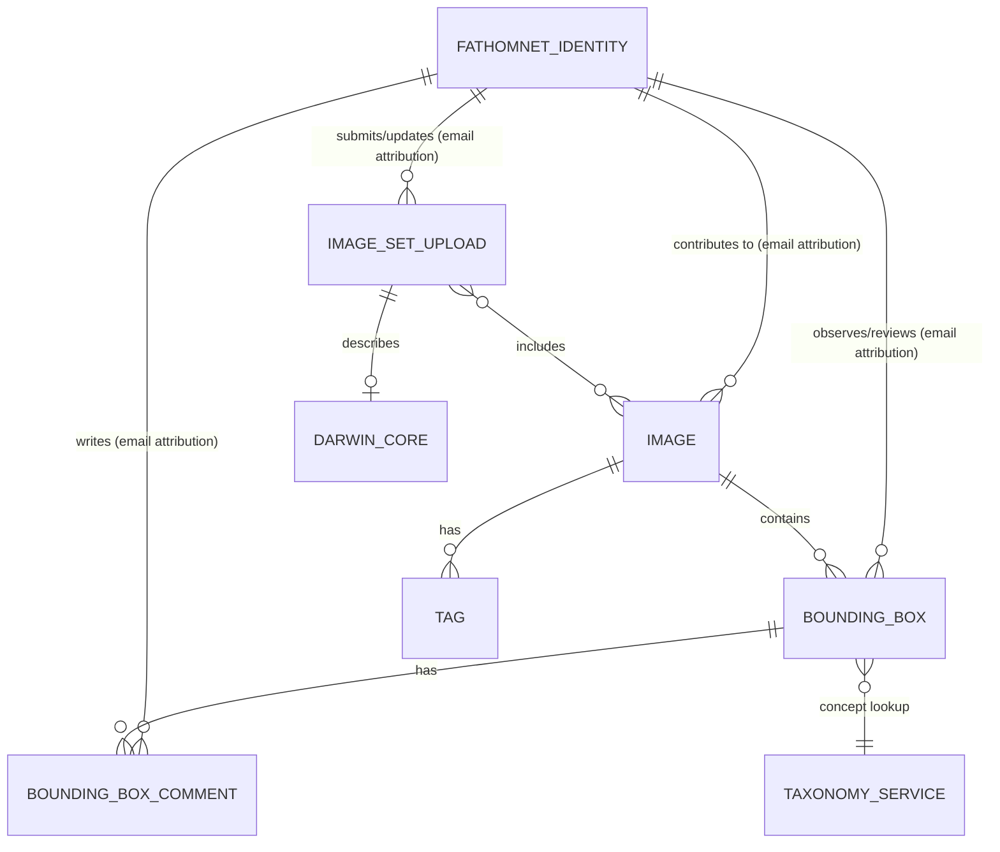

# FathomNet Database Structure

## Scope and confidence

This note reconstructs FathomNet's **logical data model** from its public REST
API and Python client. It is not a production schema dump: public materials do
not establish the exact SQL table names, indexes, foreign keys, or storage
engine. Names shown in `UPPER_SNAKE_CASE` are useful relational equivalents,
not confirmed physical tables.

The central object is an **Image**. Images have annotations, flexible metadata,
and dataset-upload membership. Annotations use a concept string that is resolved
through a separate taxonomy service.

## Entity relationships



The identity links above are conceptually useful, but the public API exposes
many of them as email fields rather than clear `user_id` foreign keys.

## Image

Logical table: `IMAGE`

| Field | Meaning |
|---|---|
| `id`, `uuid` | Internal and stable public identifiers; treat `uuid` as the external identifier. |
| `url`, `sha256` | Image location and integrity value. |
| `width`, `height` | Pixel dimensions. |
| `timestamp`, `latitude`, `longitude`, `depth_meters`, `altitude` | Time and location/deployment context. |
| `temperature_celsius`, `salinity`, `oxygen_ml_l`, `pressure_dbar` | Environmental measurements when available. |
| `media_type`, `imaging_type` | Media/camera metadata. |
| `contributors_email` | Attribution. |
| `valid`, `last_validation`, `modified` | Validation and update information. |
| `created_timestamp`, `last_updated_timestamp` | Record lifecycle timestamps. |

Relationships:

- One image has zero or more bounding boxes.
- One image has zero or more tags.
- One image can belong to zero or more image-set uploads.

The prototype's `fetch` command uses this API shape directly: it reads an image
record, its `url`, dimensions, and embedded `boundingBoxes` array.

## Bounding box annotation

Logical table: `BOUNDING_BOX`

| Field | Meaning |
|---|---|
| `id`, `uuid` | Annotation identifiers. |
| `image_uuid` | Inferred image reference; the public DTO exposes this relationship. |
| `user_defined_key` | Source-system or user-supplied identifier. |
| `concept`, `alt_concept` | Organism/object concept and proposed alternative. |
| `x`, `y`, `width`, `height` | Rectangle in image pixels; `(x, y)` is the upper-left corner. |
| `group_of`, `occluded`, `truncated` | Annotation qualifiers. |
| `observer`, `reviewer` | Attribution fields. |
| `review_state` | Curation status. |
| `last_reviewed_timestamp`, `created_timestamp`, `last_updated_timestamp` | Annotation lifecycle timestamps. |

The public review states are:

```text
UNKNOWN
UNVERIFIED
VERIFIED
REJECTED
```

For the SAM proof of concept, a bounding box is an **existing annotation prompt**.
It is not evidence that every visible organism in the image has been labeled.

### Bounding-box comments

Logical table: `BOUNDING_BOX_COMMENT`

| Field | Meaning |
|---|---|
| `uuid` | Comment identifier. |
| `bounding_box_uuid` | Reference to the annotation being discussed. |
| `email` | Comment author attribution. |
| `text` | Review discussion. |
| `alternate_concept` | Suggested replacement concept. |
| `flagged` | Flag/review signal. |
| timestamps | Creation and update times. |

Relationship: one bounding box has zero or more comments. This supports a
review workflow without replacing the annotation's original concept directly.

## Tags

Logical table: `TAG`

| Field | Meaning |
|---|---|
| `id`, `uuid` | Tag identifiers. |
| `image_uuid` | Image reference. |
| `key`, `value` | Arbitrary metadata pair. |
| `media_type` | Value/media representation. |
| timestamps | Creation and update times. |

Tags make image metadata extensible. For example, the live API records used in
this project include tags such as `fathomverse_image_id`.

## Image-set uploads and Darwin Core

An `ImageSetUpload` represents an import or submitted image collection, not a
single image.

Logical table: `IMAGE_SET_UPLOAD`

| Field | Meaning |
|---|---|
| `id`, `uuid` | Upload identifiers. |
| `contributors_email` | Submitter attribution. |
| `format`, `local_path`, `remote_uri`, `sha256` | Import/source details. |
| `status`, `rejection_reason`, `rejection_details` | Import review state. |
| `status_updater_email`, `status_update_timestamp` | Curation attribution. |
| timestamps | Creation and update times. |

Public upload statuses are:

```text
PENDING
ACCEPTED
REJECTED
```

The API exposes both `ImageSetUpload.images` and `Image.imageSetUploads`, which
strongly indicates a many-to-many relation. A relational implementation would
normally use a bridge such as `IMAGE_UPLOAD_MEMBERSHIP` with `image_uuid` and
`image_set_upload_uuid`.

An upload may have Darwin Core dataset metadata. Logical table: `DARWIN_CORE`.
Typical fields include `dataset_id`, `dataset_name`, institution/collection
identifiers, `license`, `rights_holder`, `bibliographic_citation`, and
`basis_of_record`. The API shape suggests an effective one-to-zero-or-one
relationship from upload to Darwin Core metadata, though the physical database
cardinality is not public.

## Identity and permissions

`FathomnetIdentity` represents a user/account. Its public fields include:

```text
id, uuid, firebase_uid, email, display_name, avatar_url, orcid,
organization, job_title, profile, expertise_rank, roles, role_data,
api_key, disabled, notification_frequency, created_timestamp,
last_updated_timestamp
```

Known roles include `READ`, `WRITE`, `UPDATE`, `MODERATOR`, `ADMIN`, and
`UNKNOWN`.

The API commonly uses email strings for attribution:

```text
Image.contributorsEmail
BoundingBox.observer
BoundingBox.reviewer
ImageSetUpload.contributorsEmail
ImageSetUpload.statusUpdaterEmail
BoundingBoxComment.email
```

It is unknown whether the production database stores those as direct email
values, hidden foreign keys, or both.

## Taxonomy and concepts

Bounding boxes expose `concept` as a string rather than a confirmed internal
`taxon_id`. Concept lookup is therefore best understood as a connection to a
taxonomy service, not a proven database foreign key.

FathomNet's public taxonomy tooling is based on WoRMS and is extended with
FathomNet-specific branches, including non-biological concepts such as geology
and equipment. A concept may therefore be an organism name, a broader marine
category, or another annotated object type.

## Other public entities

| Entity | Purpose / notable fields |
|---|---|
| `MarineRegion` | Geographic lookup metadata: `id`, `MRGID`, `name`, and latitude/longitude bounds. |
| `FollowedTopic` | Topic subscriptions/notifications: `uuid`, `email`, `topic`, `target`, `notification`, and timestamps. |

## What this project should assume

- Use API `uuid` values as stable external references.
- Treat `Image → BoundingBox` and `Image → Tag` as one-to-many.
- Treat `ImageSetUpload ↔ Image` as many-to-many.
- Preserve original box provenance and review status in any local dataset.
- Treat `concept` as taxonomy-backed text, not as a guaranteed local integer key.
- Do not claim exact physical table names, constraints, indexes, or database
  technology without backend documentation or a schema export.

## Public references

- [FathomNet Python client](https://github.com/fathomnet/fathomnet-py)
- [FathomNet REST API example](https://database.fathomnet.org/api/images?page=10&size=10)
- [FathomNet taxonomy/WoRMS service](https://github.com/fathomnet/worms-server)
