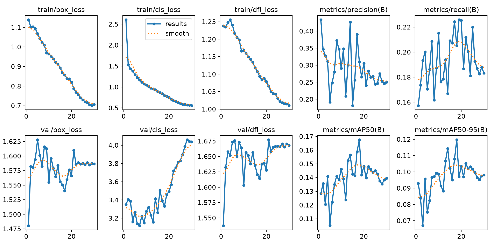
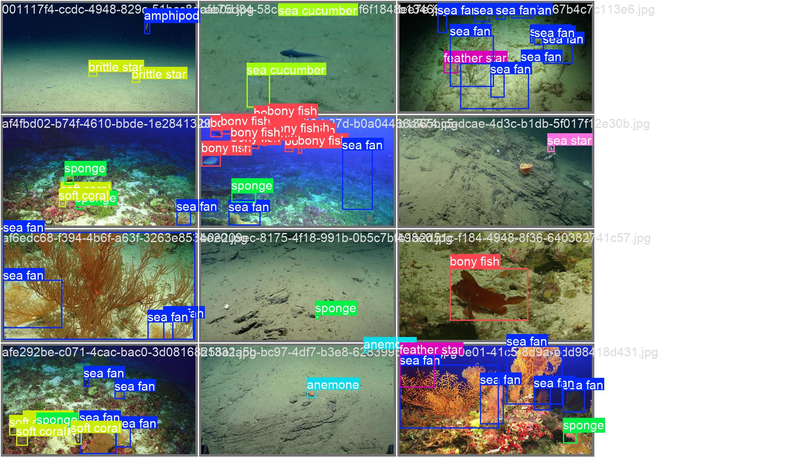
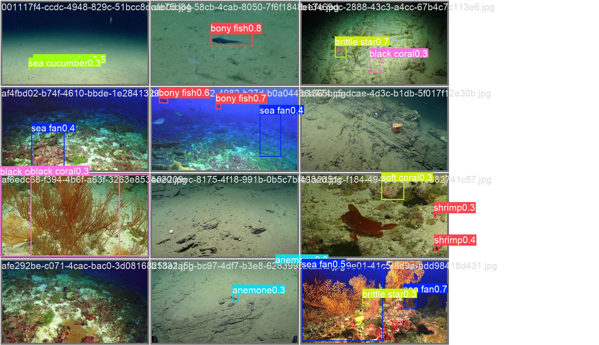

# Report: Fine-tuning MBARI-315k-YOLOv8x for FathomNetCLEF2026

| | |
|---|---|
| Date | 2026-10-31 |
| Goal | Test whether a detector pretrained on MBARI imagery (the test domain) closes the train/test gap |
| Approach | Same supervised pipeline as the [YOLO11s baseline](2026-10-yolo11s-baseline.md); only the starting weights and model size change; no positive-unlabeled handling |
| Kaggle score | **Public 0.0767 / Private 0.0668** (mAP@[.5:.95], late submission), about 2× the baseline |
| Submission ref | 57856623 |
| Code | `src/una/baseline.py`, CLI `una train --model ... / predict / submission` |

## 1. Why this model

The baseline report named domain shift as the first reason its test score (0.037) was
about 4× below validation (0.139): train and validation images come from SOI, NOAA and
HURL, while every test image is from MBARI. The highest-priority next step was
therefore to start from a detector that has already seen MBARI imagery.

[`FathomNet/MBARI-315k-yolov8`](https://huggingface.co/FathomNet/MBARI-315k-yolov8) is a
YOLOv8x detector released by FathomNet. It was trained on FathomNet and MBARI's internal
VARS annotations to detect 499 marine taxa (CC-BY-4.0).

| | YOLO11s baseline | MBARI-315k-YOLOv8x |
|---|---|---|
| Pretraining data | COCO (everyday objects, 80 classes) | FathomNet + MBARI VARS (499 marine taxa) |
| Parameters | 9.4M | 68.6M |
| Classes in checkpoint | 80 | 499 (head replaced with 32 classes) |

FathomNet also publishes [`megalodon-2023-yolov8`](https://huggingface.co/FathomNet/megalodon-2023-yolov8),
a YOLOv8x of the same size with a single `object` class. It finds organisms but does not
tell them apart, so it is a poorer starting point for 32-class detection. It is a
candidate for pseudo-labeling instead (section 7).

## 2. Setup

Everything except the model and batch size matches the baseline: the same exported
`yolo/` dataset (5,509 train / 954 val images, dive-grouped split, `seed=0`), the same
augmentation and the same prediction and submission settings.

| Setting | YOLO11s baseline | MBARI-315k-YOLOv8x |
|---|---|---|
| Starting weights | `yolo11s.pt` | `mbari_315k_yolov8.pt` |
| Image size | 1024 | 1024 |
| Epochs / batch | 30 / 4 | 30 / **6** (919 iterations per epoch) |
| Optimizer | AdamW, lr 0.000278 (`optimizer=auto`), cosine | same |
| Augmentation | Ultralytics defaults + up-down flip 0.5 | same |
| Hardware / time | RTX 3060 Ti 8 GB, 1.6 h | RTX 5080 16 GB, 2.2 h (~4.5 min/epoch) |
| Prediction | `best.pt`, imgsz 1024, `conf=0.001`, `max_det=300` | same (`best.pt` = epoch 18) |

The run was too slow for the local 8 GB card (estimated 30 to 45 min per epoch at
1024 px; see the baseline report), so it was trained on a second machine with an
RTX 5080. Only the exported `yolo/` folder and the test images were moved.

Before upload, the CSV was regenerated with `una submission`, which checks every
`image_id` and `category_id` against the test manifest. The regenerated file was
byte-identical to the submitted one: 60,249 boxes covering all 1,425 test images.

## 3. Results

### 3.1 Headline

| | YOLO11s | MBARI-315k-YOLOv8x | Change |
|---|---:|---:|---:|
| **Kaggle public** | 0.0371 | **0.0767** | +107% |
| **Kaggle private** | 0.0321 | **0.0668** | +108% |
| Validation mAP@[.5:.95] (best.pt) | **0.139** | 0.119 | −14% |
| Validation mAP@.5 | **0.185** | 0.167 | |
| Validation precision / recall | 0.331 / 0.222 | 0.311 / 0.205 | |
| Validation ÷ test (public) | 3.7× | 1.6× | |

**The test score doubled while the validation score fell.** Ranking the two models by
validation mAP would have discarded the better model. This is the most important
finding of the run (section 4).

### 3.2 Training curves



| Epoch | YOLO11s mAP | MBARI mAP | YOLO11s val cls loss | MBARI val cls loss | MBARI train cls loss |
|---:|---:|---:|---:|---:|---:|
| 1 | 0.018 | **0.093** | 4.04 | 3.35 | 2.61 |
| 5 | 0.046 | 0.075 | 3.43 | 3.27 | 1.29 |
| 10 | 0.072 | 0.099 | 3.44 | 3.27 | 1.05 |
| 15 | 0.080 | 0.102 | 3.45 | 3.26 | 0.89 |
| 18 (MBARI best) | | **0.120** | | 3.33 | 0.80 |
| 20 | 0.087 | 0.103 | 3.33 | 3.49 | 0.75 |
| 25 | 0.112 | 0.102 | 3.43 | 3.83 | 0.61 |
| 30 | 0.103 | 0.098 | 3.46 | **4.04** | 0.56 |

- **Fast start.** After one epoch the MBARI model already reached 0.093, the baseline's
  level at epoch 13. Marine features transfer immediately.
- **Early plateau.** Validation mAP stayed around 0.10 from epoch 10 on. The epoch 18
  peak of 0.120 stands out and is probably partly noise.
- **Stronger overfitting.** Training classification loss kept falling (2.61 → 0.56),
  while validation classification loss rose 24% after epoch 15 (3.26 → 4.04). The
  baseline's validation classification loss stayed flat at 3.3 to 3.5. The
  68.6M-parameter model memorizes the training dives quickly, so about half of the 30
  epochs added nothing.

### 3.3 Per-class validation (best.pt)

Both `best.pt` checkpoints were re-validated on the same split with the same settings.
The baseline reproduced its 0.139 exactly.

| Class | Val boxes | YOLO11s | MBARI | Note |
|---|---:|---:|---:|---|
| sea fan | 1,284 | 0.137 | **0.166** | Recall 0.08 → 0.12 at precision 0.73 |
| anemone | 336 | **0.058** | 0.038 | |
| bony fish | 330 | 0.051 | **0.074** | Precision 0.22 → 0.43 |
| sponge | 325 | 0.011 | 0.007 | Still near zero |
| brittle star | 253 | 0.043 | **0.066** | |
| sea cucumber | 160 | 0.102 | 0.098 | |
| sea star | 109 | 0.053 | 0.052 | |
| shrimp | 92 | 0.018 | **0.055** | Small objects, 3× better |
| black coral | 64 | 0.136 | 0.134 | |
| feather star | 59 | 0.013 | 0.017 | |
| stony coral | 40 | **0.118** | 0.027 | Largest loss among classes with ≥ 10 boxes |
| soft coral | 35 | 0.012 | **0.081** | |
| crab | 19 | 0.060 | **0.211** | |
| octopus / pyrosome / urchin | 1 / 3 / 5 | **0.895 / 0.658 / 0.121** | 0.224 / 0.358 / 0.029 | One to five boxes each |

Averaged by how many validation boxes a class has:

| Classes | Count | YOLO11s mean mAP | MBARI mean mAP | MBARI wins |
|---|---:|---:|---:|---:|
| All with any val box | 30 | **0.139** | 0.119 | 18 / 30 |
| ≥ 10 val boxes | 19 | 0.054 | **0.071** | 13 / 19 |
| ≥ 50 val boxes | 10 | 0.062 | **0.071** | 5 / 10 |

**The lower overall validation mAP comes entirely from classes with fewer than 10
validation boxes.** mAP weighs every class equally, so a single octopus box moves the
headline as much as 1,284 sea fan boxes. The 11 classes with under 10 boxes account for
a summed per-class loss of 0.92, or −0.031 on the 30-class mean. That is more than the
whole −0.020 gap. On the classes with enough boxes to measure, the MBARI model is better.

Example validation batch, labels vs predictions:

| Ground truth | Predictions |
|---|---|
|  |  |

### 3.4 Test predictions

Without test labels, these numbers describe behavior, not accuracy.

| | YOLO11s | MBARI-315k-YOLOv8x |
|---|---:|---:|
| Boxes at `conf ≥ 0.001` | 66,542 (46.7 per image) | 60,249 (42.3 per image) |
| Boxes at `conf ≥ 0.25` | 1,699 | **2,439** (+44%) |
| Boxes at `conf ≥ 0.5` | 655 | **1,168** (+78%) |
| Images with no box at `conf ≥ 0.25` | 583 (41%) | **444 (31%)** |
| Median box area at `conf ≥ 0.25` (fraction of image) | 1.32% | **0.82%** |
| Classes predicted at `conf ≥ 0.25` | 26 | 29 |
| Most common confident classes | sponge, bony fish, urchin, sea fan | bony fish, sea fan, brittle star, urchin |

- **More confident detections on MBARI images.** The MBARI model is sure about many
  more boxes and leaves fewer test images empty. This fits the domain argument.
- **Smaller objects.** The median confident box is about 40% smaller at the same input
  size. The larger model and marine pretraining likely both contribute.
- **Less confident sponge.** The baseline's most frequent confident class was sponge
  (306 boxes), its weakest validation class (0.011). The MBARI model predicts 166, which
  suggests fewer confident false positives.

## 4. Analysis

1. **The domain gap was real and large.** The validation-to-test ratio dropped from
   3.7× to 1.6×. Pretraining on MBARI imagery helped exactly where the baseline report
   predicted.
2. **Validation mAP cannot rank models across pretraining domains.** Validation images
   share the training sources, so the main advantage of this model is invisible to it.
   Validation mAP is also dominated by noise from classes with one to five boxes.
   Choosing a checkpoint *within* a run by validation is still reasonable. Choosing
   *between* runs by validation is not.
3. **Two changes are confounded.** Model capacity (9.4M → 68.6M) and pretraining domain
   (COCO → MBARI marine taxa) changed together. The run shows that the combination
   helps, but not how much each part contributes. A COCO-pretrained `yolov8x` with the
   same recipe would separate them.
4. **The positive-unlabeled problem is untouched.** Recall stays around 0.2. Training
   still teaches the model to treat unlabeled organisms as background. 0.077 is above
   the reported public median (~0.05) but far from the top (~0.28 to 0.30).
5. **Possible pretraining overlap.** MBARI-315k was trained on public FathomNet and
   MBARI VARS data. Some competition test images may have been seen during
   pretraining. This has not been checked.

## 5. Lessons about the process

- Check the score on Kaggle before discarding a run with lower validation mAP.
- Report per-class validation together with the number of boxes. A headline mAP over
  classes with one box hides more than it shows.
- A worktree has no `una.config.json`. Set `UNA_DATA_ROOT` (and `PYTHONPATH=src` if
  the package is not installed there) before running `una`, or the data root falls
  back to `<repo>/data`.
- Remote training writes absolute paths into `args.yaml` and `test_predictions.json`
  (`D:\Dev\Test\...`). They are informational only; `una submission` reads the image
  list from the local test manifest.

## 6. Comparison at a glance

| | YOLO11s | MBARI-315k-YOLOv8x |
|---|---|---|
| Kaggle public / private | 0.0371 / 0.0321 | **0.0767 / 0.0668** |
| Validation mAP@[.5:.95] | **0.139** | 0.119 |
| Validation mAP, classes ≥ 10 boxes | 0.054 | **0.071** |
| Best epoch | 17 | 18 |
| Overfitting after peak | mild | strong (val cls loss +24%) |
| Training time | 1.6 h (RTX 3060 Ti) | 2.2 h (RTX 5080) |

## 7. Next steps

| Priority | Idea | Expected effect |
|---|---|---|
| 1 | **Pseudo-label self-training** with this model as teacher: add confident detections that don't overlap existing boxes, retrain | Attacks the positive-unlabeled problem; this model is a stronger teacher on MBARI-like scenes |
| 2 | Use **Megalodon** (class-agnostic) to propose unlabeled organisms and classify them with this model; keep uncertain candidates out of the background | A second, complementary source of pseudo-labels |
| 3 | Shorter schedule (~15 epochs), lower learning rate or a frozen backbone | Same or better score in about half the time; less overfitting |
| 4 | Build a better model-selection signal than the current validation (Kaggle submissions or an MBARI-like proxy set) | Avoids discarding better models |
| 5 | COCO `yolov8x` with the same recipe | Separates the effect of model size from MBARI pretraining |

## 8. Reproduce

Download `mbari_315k_yolov8.pt` from
[FathomNet/MBARI-315k-yolov8](https://huggingface.co/FathomNet/MBARI-315k-yolov8) into
`<data_root>/weights/`.

```powershell
python -m pip install -e .[yolo]   # plus a CUDA build of PyTorch
una yolo-export                    # skip if <data_root>/yolo already exists
una train --model <data_root>/weights/mbari_315k_yolov8.pt --batch 6 --name mbari315k-yolov8x
una predict --name mbari315k-yolov8x
una submission --name mbari315k-yolov8x
kaggle competitions submit -c fathomnet-2026 -f <data_root>/runs/mbari315k-yolov8x/submission.csv -m "MBARI-315k-YOLOv8x fine-tune"
```

Run artifacts (weights, curves, `test_predictions.json`, `submission.csv`) live in
`<data_root>/runs/mbari315k-yolov8x/`, outside the repository.
