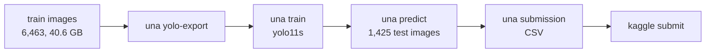
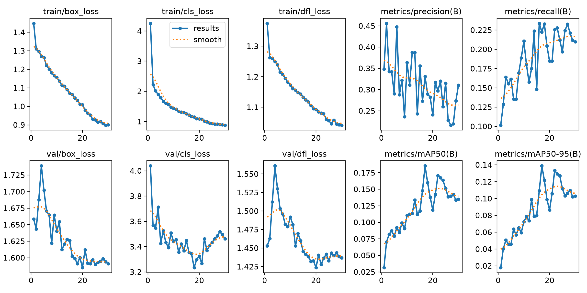
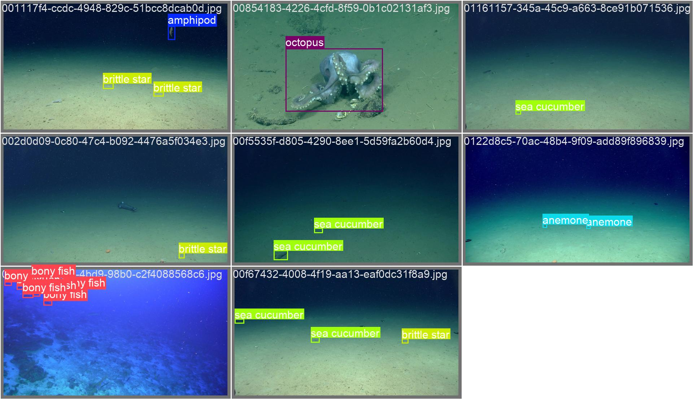
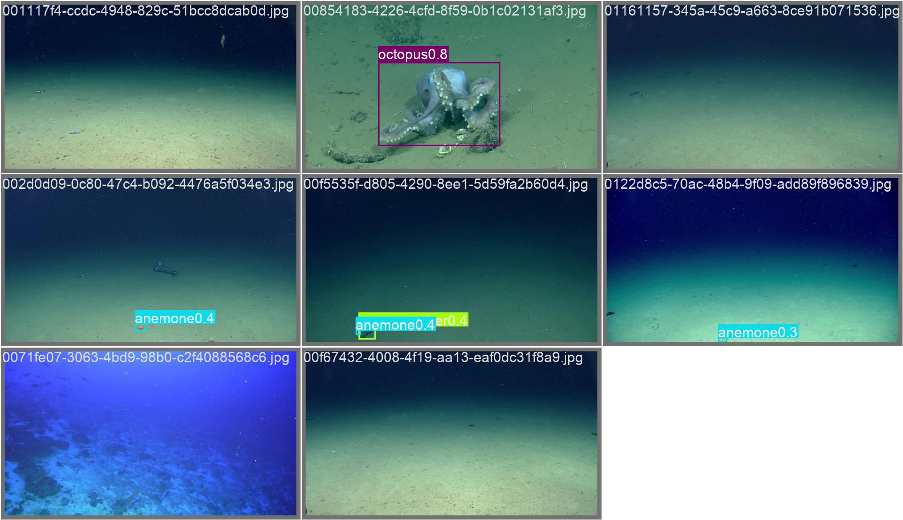

# Report: YOLO11s supervised baseline for FathomNetCLEF2026

| | |
|---|---|
| Date | 2026-10-25 |
| Goal | Run the full pipeline once, end to end, and get a reference score |
| Approach | Plain supervised fine-tuning of `yolo11s`; no positive-unlabeled handling |
| Kaggle score | **Public 0.0371 / Private 0.0321** (mAP@[.5:.95], late submission) |
| Submission ref | 57640170 |
| Code | `src/una/baseline.py`, CLI `una yolo-export / train / predict / submission` |

## 1. Why this baseline

The aim was not a high score but to exercise every step from raw data to a scored
Kaggle submission, using the simplest reasonable detector. The model deliberately
ignores the central difficulty of the competition (unlabeled organisms in training
images) so that later PU-aware methods have a clean reference point.

## 2. The competition in brief

- **Task:** detect and classify marine organisms into 32 groups.
- **Train:** 6,463 images, 22,225 boxes. Labels are *incomplete*: experts labeled only
  the taxa they study, so many visible organisms have no box.
- **Test:** 1,425 images, *fully* labeled, held by Kaggle.
- **Metric:** COCO mAP averaged over IoU 0.50–0.95.
- **Submission:** CSV with `annotation_id, image_id, category_id, bbox_x, bbox_y,
  bbox_width, bbox_height, score`, boxes in original-image pixels (COCO `xywh`).
- **Domain shift:** train comes from SOI, NOAA and HURL; test is 100% MBARI.

## 3. Pipeline



### 3.1 `una yolo-export`: convert the data

| Step | What | Why |
|---|---|---|
| Resize | Longest side to 1280 px, saved as JPEG (q95) | SOI frames are 4K PNG (33 GB). Decoding them every epoch would starve the GPU. Result: 2.2 GB. |
| Labels | COCO `[x, y, w, h]` px → YOLO `cls cx cy w h` normalized, clipped to the image, degenerate boxes dropped | Normalized coordinates survive the resize unchanged. |
| Class ids | Sparse COCO ids (1..41 with 9 gaps) → dense 0..31, saved to `classes.json` | YOLO needs contiguous indices; the reverse map restores ids for submission. |
| Validation split | Whole dives, seeded (`seed=0`), up to 15% of images | Consecutive frames from one dive are near duplicates; a random split leaks them and inflates scores. |

Resulting split: **5,509 train / 954 val** images. Validation dives:
`HURL/D2-EX2301-06`, `HURL/D2-EX2301-07`, `SOI_FK200802_S0392`.

### 3.2 `una train`: fine-tune YOLO11s

| Setting | Value |
|---|---|
| Model | `yolo11s.pt` (COCO-pretrained, 9.4M parameters, 21.5 GFLOPs) |
| Image size | 1024 |
| Epochs / batch | 30 / 4 (1,378 iterations per epoch) |
| Optimizer | AdamW, lr 0.000278 (chosen by Ultralytics `optimizer=auto`), cosine schedule |
| Augmentation | Ultralytics defaults (mosaic, HSV, scale 0.5, left-right flip) **plus** up-down flip 0.5, since underwater orientation is arbitrary |
| Mixed precision | on |
| Hardware | RTX 3060 Ti 8 GB, 2.9 GB VRAM used |
| Time | ~2.3 min/epoch, 1.6 h wall clock (includes ~29 min paused by system sleep during epoch 8) |

Ultralytics saves `last.pt` every epoch and `best.pt` whenever validation improves,
so the sleep pause cost time but no progress.

### 3.3 `una predict`: run on the test set

- Original-resolution test images, `imgsz=1024`, weights `best.pt`.
- `conf=0.001`, `max_det=300`. A very low threshold is intentional: mAP integrates the
  whole precision-recall curve, so low-score boxes can add recall but never subtract.
- Output: 66,542 boxes over all 1,425 images (≈47 per image).

### 3.4 `una submission`: write the CSV

- `xyxy` → COCO `xywh`, clipped to the image; zero-area boxes dropped.
- Dense class index → original `category_id`; `image_id` taken verbatim from
  `test_dataset.json` (ids collide with train, so they must never be mixed).
- Validation before writing: every `image_id` and `category_id` must exist in the test
  manifest, otherwise the command fails.

## 4. Results

### 4.1 Validation during training



| Epoch | Precision | Recall | mAP@.5 | mAP@[.5:.95] |
|---:|---:|---:|---:|---:|
| 1 | 0.348 | 0.102 | 0.032 | 0.018 |
| 5 | 0.290 | 0.161 | 0.079 | 0.046 |
| 10 | 0.364 | 0.211 | 0.111 | 0.072 |
| 13 | 0.387 | 0.175 | 0.134 | 0.099 |
| **17 (best)** | **0.331** | **0.223** | **0.185** | **0.139** |
| 22 | 0.297 | 0.226 | 0.171 | 0.134 |
| 25 | 0.315 | 0.197 | 0.151 | 0.112 |
| 30 | 0.310 | 0.210 | 0.135 | 0.103 |

Validation mAP peaked at epoch 17 and then drifted down, a sign of overfitting to the
training dives. The submitted model is the epoch 17 checkpoint (`best.pt`).

### 4.2 Per-class validation (best.pt)

Only 27 of 32 classes appear in the validation dives, and many have fewer than 10
boxes, so per-class numbers are noisy.

| Class | Val boxes | mAP@[.5:.95] | Note |
|---|---:|---:|---|
| sea fan | 1,284 | 0.137 | Precision 0.69 but recall 0.08: finds few, but those are right |
| anemone | 336 | 0.057 | |
| bony fish | 330 | 0.051 | |
| sponge | 325 | 0.011 | Amorphous shapes, hard to box |
| brittle star | 253 | 0.043 | |
| sea cucumber | 160 | 0.100 | |
| sea star | 109 | 0.053 | |
| shrimp | 92 | 0.018 | Small objects |
| black coral | 64 | 0.136 | |
| feather star | 59 | 0.013 | |
| stony coral | 40 | 0.119 | |
| larvacean / octopus / pyrosome | 4 / 1 / 3 | 0.87 / 0.90 / 0.66 | Too few boxes to mean much |
| urchin | 5 | 0.121 | The **most common** training class (5,723 boxes) is almost absent from validation |

Example validation batch, labels vs predictions:

| Ground truth | Predictions |
|---|---|
|  |  |

### 4.3 Kaggle test

| | mAP@[.5:.95] |
|---|---:|
| Validation (best.pt) | 0.139 |
| **Kaggle public** | **0.0371** |
| **Kaggle private** | **0.0321** |

For context: other teams report naive baselines around 0.03, a public median near 0.05,
and top solutions near 0.28 to 0.30.

## 5. Analysis: why the test score is ~4× lower than validation

1. **Domain shift.** Every training and validation image is SOI, NOAA or HURL; every
   test image is MBARI. Camera, lighting, habitat and annotation style all change.
   Validation on held-out *training* dives cannot measure this gap.
2. **Positive-unlabeled training labels.** An organism without a box is learned as
   background. The model is trained to *suppress* exactly the objects the fully
   labeled test set expects it to find. This mostly hurts recall, which stays near
   0.2 even on validation.
3. **Incomplete validation labels.** Validation uses the same incomplete labels as
   training, so some "false positives" there are real organisms. Validation
   precision is therefore pessimistic, while the domain gap makes it optimistic
   overall.
4. **Small model, small objects.** `yolo11s` at 1024 px struggles with small or
   amorphous classes (shrimp, sponge, feather star).
5. **Class imbalance across splits.** Urchins dominate training but are nearly absent
   from validation, so validation does not reflect the class mix the model learned.

## 6. Lessons about the process

- Keep download, export, training and prediction as separate, resumable steps. The
  system-sleep pause cost time but no work.
- Check the submission against the test manifest before uploading. Category-id gaps
  and train/test image-id collisions are easy to get wrong silently.
- The Kaggle CLI (v2.2.5) expects a new-style `KGAT_…` token in
  `~/.kaggle/access_token`, not in `kaggle.json`.
- On Windows, any script that starts Ultralytics training needs an
  `if __name__ == "__main__":` guard, or the data-loader workers crash.

## 7. Next steps

| Priority | Idea | Expected effect |
|---|---|---|
| 1 | Fine-tune **MBARI-315k-YOLOv8x** (`FathomNet/MBARI-315k-yolov8`, 68.6M params, 499 marine taxa) | Pretrained on MBARI imagery, the test domain; attacks cause 1 |
| 2 | **Pseudo-label self-training**: add confident detections that don't overlap existing boxes as new labels, retrain | Attacks cause 2; the core of the competition |
| 3 | Newer architecture (YOLO26) | Small, incremental gain |

A short benchmark of MBARI-315k-YOLOv8x on the 3060 Ti:

| imgsz / batch | Peak VRAM | Estimated time per epoch |
|---|---|---|
| 1024 / 4 | 8.5 GB (exceeds 8 GB) | ~45 min |
| 1024 / 2 | 5.0 GB | ~30–45 min |
| 640 / 8 | 7.0 GB | ~10–25 min |

A 30-epoch run at 1024 px would take most of a day locally, so the plan is to train it on a
faster machine. Only the exported `yolo/` folder (2.2 GB) and the test images (4.4 GB)
need to move, not the 40.6 GB of original training images.

## 8. Reproduce

```powershell
python -m pip install -e .[yolo]   # plus a CUDA build of PyTorch
una doctor
una yolo-export
una train
una predict
una submission
kaggle competitions submit -c fathomnet-2026 -f <data_root>/runs/yolo11s-baseline/submission.csv -m "yolo11s baseline"
```

Run artifacts (weights, curves, `test_predictions.json`, `submission.csv`) live in
`<data_root>/runs/yolo11s-baseline/`, outside the repository.
